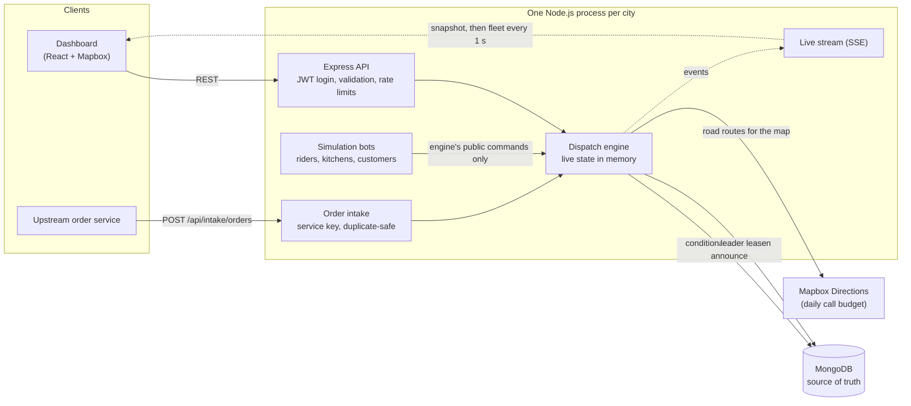
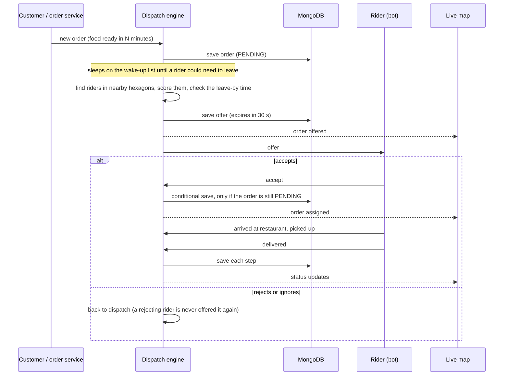
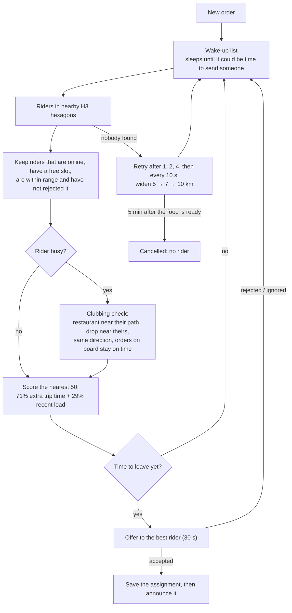
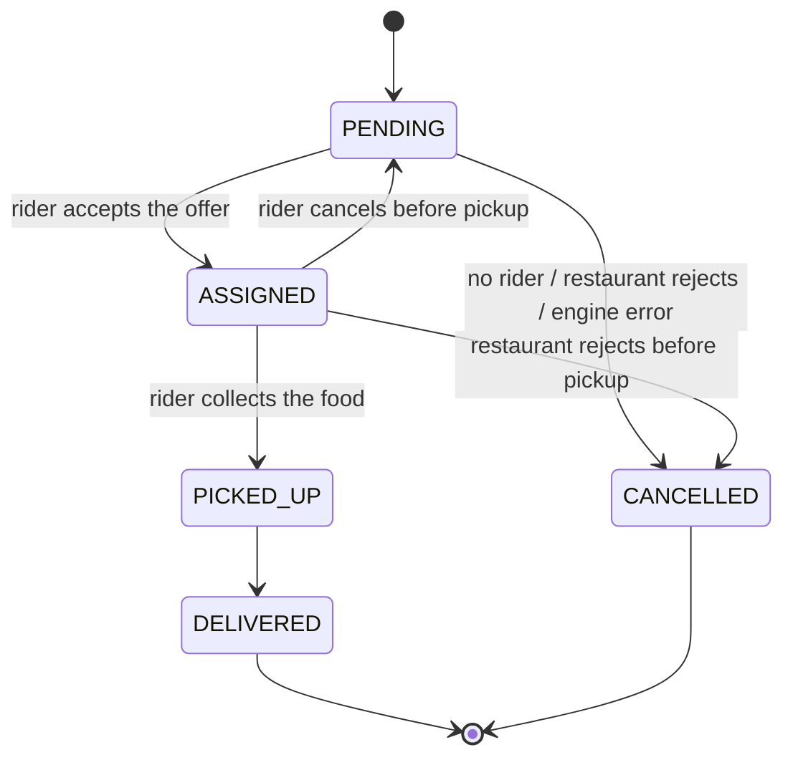

# Delivery Partner Allocation Engine

A working prototype of the **dispatch engine behind food-delivery apps like Swiggy and Zomato**: the system that decides **which delivery partner takes each order, and when they set off**.

It runs one city (Ranchi) with a simulated fleet of riders, kitchens and customers, so every decision can be watched live on a map and tested end to end. The design follows what Swiggy, DoorDash and Uber have described publicly about their own dispatch.

> **The core idea:** for each order, pick the rider who adds the **least extra delivery time** to their current trip (idle or already carrying an order), send them so they **arrive as the food is ready**, and treat the assignment as an **offer** the rider can turn down.

## Live demo

| Version | What it is | App | Code |
|---|---|---|---|
| **Current** | The engine this README describes: least-extra-time scoring, clubbing, just-in-time hold, offers, crash recovery | [nexrouted.vercel.app](https://nexrouted.vercel.app) | `main` |
| **v1** (earlier, simpler) | H3 shortlist, then a weighted score of arrival time, rating and recent load; one order per rider, with a queued next order | [nexroute-v1.vercel.app](https://nexroute-v1.vercel.app) | [`v1`](https://github.com/rishabhhS17/Delivery-Partner-Allocation-Engine-/tree/v1) |

Both run on free hosting, so the first visit after a quiet spell takes about a minute while the backend wakes up.

---

## Why "send the nearest free rider" is not enough

| What goes wrong with nearest-free-rider | What this engine does instead |
|---|---|
| The nearest rider may be busy; distance is not arrival time | Scores every rider by the **seconds this order adds to their trip** (marginal cost) |
| A rider already going the same way is ignored | **Clubbing:** a busy rider can carry up to **2 orders** if the route fits |
| The rider arrives before the food is cooked and waits at the counter | **Just-in-time hold:** the rider is sent at *food ready − travel time − a small grace* |
| Riders can say no or ignore the phone | **Offers** with a 30 s timeout, re-offering and a widening search |
| The same riders near busy restaurants get every order | A **load score** (deliveries in the last 60 min) spreads the work |

---

## Architecture



**How it fits together, in plain words**

- **One process per city.** The engine keeps the live picture (riders, their stops, waiting orders, the hexagon index) in memory, so a decision never waits on a database read.
- **MongoDB is the source of truth.** Every decision is saved before it is announced. After a crash the engine rebuilds its memory from the database and carries on.
- **The engine and the bots are separate modules in the same process.** The bots stand in for rider and restaurant apps and may only call the engine's public commands. A test enforces this wall, so the bots can be swapped for real apps without touching the engine.
- **Only one instance dispatches.** During a deploy two instances can be running; a lease stored in MongoDB lets only the holder make decisions. The other one serves the API and takes over within about 15 s if the leader dies.

---

## How one order flows



### The decision, step by step



---

## Components

| Component | What it does | Where |
|---|---|---|
| **H3 index** | Riders are grouped into hexagon cells (resolution 7, about 2 km across). An order looks only at the cells around its restaurant, never the whole fleet. Straight-line distance is the final "in range" check. | `engine/h3Index.js`, `services/allocationEngine.js` |
| **Scoring** | For each candidate, works out the cheapest way to fit the new pickup and drop into their stops and how many seconds that adds. Blends it with recent load (71% / 29%, changeable at runtime). Every decision stores its full score breakdown. | `services/allocationEngine.js` |
| **Clubbing rules** | At most 2 orders per rider. The second restaurant must be within 1.5 km of the rider's path and the drop within 2 km of an existing drop, in a similar direction (within 45°). A drop due in under 2 min can't have anything inserted ahead of it (head freeze). An order within 5 min of its promised time can't be delayed at all (aging lock). | `engine/dispatch.js`, `services/allocationEngine.js` |
| **Just-in-time hold and wake-up list** | An order waiting for its food is not re-scored every second. It sleeps until a rider could need to leave, so a typical order is scored only a couple of times. | `engine/wakeList.js` |
| **Offers** | One open offer per rider, 30 s to answer. A rejecting rider is never offered that order again. Three ignored offers in a row switch a rider offline. A rider may cancel before pickup, and the order goes back to dispatch. | `engine/offers.js`, `engine/riderLifecycle.js` |
| **Search widening** | If nobody is found or nobody accepts, the search grows from 5 to 7 to 10 km, at 60 s and 120 s after the first real try. Waiting for food doesn't count. 10 km is the hard ceiling. | `config/constants.js`, `engine/dispatch.js` |
| **Promised time** | Every order gets a deadline when created: 5 min nominal first mile + prep + last mile + 10 min slack. A new order is never refused a rider for running late (late beats cancelled; the least-late rider wins), but a second order can't be fitted in any way that makes an order already on board miss its promise. | `utils/orderTiming.js`, `services/allocationEngine.js` |
| **Cancel timer** | An order still unassigned **5 min after its food is ready** is cancelled (`no_rider`), so cooking time never counts against it (a 20-min order gets until minute 25) and a kitchen delay moves the window with it. An order a rider gives back gets a fresh 5 min. Adjustable live. | `engine/dispatch.js` |
| **Storage** | The only module that talks to the database. Each assignment is one conditional update that succeeds only while the order is still waiting, so two decisions can never both win. | `engine/storage.js` |
| **Leader lease** | A 15 s lease in MongoDB, renewed every 5 s; only the holder dispatches. | `engine/leaderLease.js` |
| **Recovery** | On start, or after the presenter's crash button, the engine rebuilds riders, stops, open offers and waiting orders from the database. | `engine/hydrate.js` |
| **Live stream** | Server-Sent Events: a full snapshot on connect, then every rider once a second plus each order event. A reconnecting browser gets a fresh snapshot. | `routes/stream.js`, `engine/broadcast.js` |
| **Order intake** | For an upstream order service: its own `X-Service-Key`, and a unique `externalOrderId`, so a retried request returns the same order instead of a duplicate. | `routes/intake.js` |
| **Routing** | Mapbox road routes for drawing and moving riders on the map, cached, with a daily call budget (3,000 by default) and a straight-line fallback. Scoring uses straight-line time at 40 km/h. | `services/routingService.js` |
| **Simulation** | Rider bots move along routes and answer offers (2–8 s; by default 15% reject, 5% ignore, 2% cancel before pickup). Kitchen bots set prep times of 30–60 s (kept short so a demo moves quickly), sometimes late or early. A customer bot places an order every 10 min. All rates can be changed live. | `sim/` |
| **Health and logs** | `GET /api/health` reports event-loop delay, dispatch round time, queue sizes, time to assign, database latency and Mapbox usage. Logs are JSON lines tagged with order and rider IDs. | `engine/health.js`, `utils/logger.js` |

**The frontend** (React, Material UI, Mapbox GL) only presents what the backend decides: a live rider map, order and rider tables, an allocation history with score breakdowns, settings for weights and bot behaviour, and a presenter panel that forces edge cases (a rider rejects, the kitchen is late, a 60 s database outage, an engine crash).

---

## Failure handling

| What fails | What happens |
|---|---|
| The process crashes mid-delivery | It restarts and rebuilds its state from MongoDB; deliveries carry on from where they were |
| A deploy runs two instances at once | Only the lease holder dispatches; the other takes over within about 15 s if the leader dies |
| The database is unreachable | Dispatch pauses (no decision is made unless it can be saved) while the map keeps moving; it resumes on its own |
| One order makes the engine throw | That order is cancelled with reason `engine_error`; everyone else keeps being dispatched |
| Two decisions race for one order | The conditional save lets exactly one win |
| A retried intake request | Returns the existing order (the external ID is unique) |
| Nobody accepts an order | Re-offers, a widening search, then cancelled with reason `no_rider` 5 min after its food is ready |
| An order can no longer make its promise | It is still assigned, to the least-late rider |
| Too many waiting orders | New orders are refused with "try again shortly" once 5,000 are waiting |
| Mapbox is down or over budget | Straight-line routes |

---

## Data model (MongoDB)

| Collection | Holds | Notes |
|---|---|---|
| `orders` | One order: restaurant and customer (copied in, so history survives deletions), food-ready time, promised time, status, assigned rider, open offer, riders who rejected it, cancel reason | "Who carries this order" lives **only here**; each rider's stop list is rebuilt from orders. Indexes on status, assigned rider and time; `externalOrderId` is unique. |
| `riders` | Position, hexagon cell, online/offline, movement status (`IDLE`, `ACCEPTED`, `WAITING`, `PICKED_UP`), current leg | |
| `orderevents` | Append-only log of every change to an order | Deleted automatically after 7 days |
| `allocationhistories` | The score breakdown of every assignment | Deleted automatically after 7 days |
| `leases` | The dispatcher leader lock | |
| `restaurants`, `customers`, `users` | Reference data and logins | |



---

## What load it handles

These numbers come from tests run on 2026-11-10 on a laptop (Intel i5-12500H, 16 GB, Node 22) against a **local** MongoDB 8.2, with Mapbox off and bots set never to reject. They show what the engine can do. They are **not** a production benchmark.

**1. Cost of one dispatch decision** (in memory, 2,000 random orders per row, half the fleet already carrying an order):

| Riders in the city | Average | p99 | Decisions per second (CPU only) |
|---|---|---|---|
| 100 | 0.04 ms | 0.23 ms | ~22,000 |
| 1,000 | 0.20 ms | 0.72 ms | ~5,000 |
| 5,000 | 0.74 ms | 1.84 ms | ~1,350 |
| 20,000 | 4.9 ms | 10.2 ms | ~200 |

Scoring is capped at the 50 nearest riders, so the part that grows is scanning every rider inside the 5 km circle.

**2. A burst of orders through the full running server** (bots, database writes, live stream):

| Test | Assigned | Time from order to assignment | Slowest dispatch round | Event-loop delay (p99) | Errors |
|---|---|---|---|---|---|
| 500 riders, 1,000 orders at once | 863 within 37 s | p50 12 s, p90 21 s | 24 ms | ≤ 16 ms | 0 |
| 2,000 riders, 4,000 orders at once | 3,605 within 31 s, peak about 260 per second | p50 14 s, p90 23 s | 1.27 s | ≤ 21 ms | 0 |

- The waiting time includes up to 5 s for the engine to pick up orders written straight into the database, plus the bot's 2–8 s to answer. The engine itself was not the slow part.
- The orders left over (106 and 242) found no rider with a free, compatible slot within 10 km while the fleet was busy, and were cancelled at what was then a 180 s limit. That is fleet size, not engine speed.

**What this means:** a tier-2 city's peak (the target for this version) is well inside what one process handles. The slowest round, 1.27 s, was the first one in the big burst: it offered about 1,500 orders, **one database write after another** (about 0.8 ms each on a local database).

**Current limits, and what was not measured:**

- **Each offer and assignment is its own database write, done in sequence.** With a cloud database a few milliseconds away instead of on the same machine, a round like that grows proportionally. At 20 ms per write it would take about 30 s. This is an estimate; the deployed setup (Render + MongoDB Atlas) has **not** been load-tested yet.
- **Request rate limit:** every `/api` route, order intake included, allows **100 requests per 15 minutes per client IP** (the 101st returns `429`). That is fine for a dashboard but caps an upstream order service at about 400 orders an hour.
- **The live stream sends the whole fleet every second** to each viewer. Many viewers with a large fleet has not been measured.
- **One leader process does all dispatching** for the city.

---

## Next steps: from a tier-2 city to a metro like Bangalore or Kolkata

The algorithm stays the same. What changes is how the work is split and how fast it reaches the database. In order:

1. **Give order intake its own rate limit.** Limit the order service by its service key, not by IP, and keep the per-IP limit for logins and browsers. This is the first hard ceiling a busy city would hit.
2. **Write each round's offers in one bulk database call** instead of one awaited write per order, so a cloud database's round-trip time is paid once per round, not once per order.
3. **Load-test the deployed setup** (Render + Atlas) with the same burst test to get real numbers with network latency.
4. **Split the API from the dispatcher.** Run several stateless API processes plus one dispatcher, with new orders passed through a queue (Redis Streams), so the API stays up while the dispatcher restarts. Trigger: event-loop delay above 100 ms (p99) on one process.
5. **Split the city into dispatch zones.** Swiggy describes dividing a city into logistic zones and running assignment for each zone separately to keep it fast. Here: one dispatcher per group of H3 cells, each with its own lease, and rider positions and hexagon cells moved to Redis so a zone can see riders just across its border.
6. **Match orders in batches.** Instead of one order at a time, match all due orders in a zone against its riders together each round. Swiggy describes an optimiser that does this per run. The scoring stays the same; only the matching step changes.
7. **Use road travel times in scoring.** Cache travel times between hexagon pairs instead of straight-line distance at 40 km/h, the way Swiggy caches distances between geohash pairs.
8. **Lighter live stream.** Send only riders that moved, and only the zone a viewer is looking at.
9. **Metrics.** A Prometheus endpoint and Grafana dashboards for round time, queue depth and time to assign.

**Other planned work:** a separate Trip record for each rider's itinerary; rider acceptance rate as a scoring input; delivery OTP at the door; rider movement paced by real route durations; a demand heatmap on the H3 grid; TypeScript; moving to Postgres + PostGIS if the data model outgrows MongoDB. Every decision taken so far is in [DECISIONS_MADE.md](DECISIONS_MADE.md); features deliberately held back are in [LATER.md](LATER.md).

---

## Tech stack

| Technology | Role | Why |
|---|---|---|
| **Node.js 20 + Express** | API, engine and bots in one process | One event loop keeps all dispatch state in memory with no locking; enough for one city's volume |
| **MongoDB + Mongoose** | Source of truth | Orders are self-contained documents; conditional single-document updates give safe assignments; TTL indexes clean up old history |
| **h3-js** | Spatial index | Equal-sized hexagons, and every neighbour is the same distance away, so nearby-cell searches are even (Uber's H3; Swiggy uses geohash for the same job) |
| **Server-Sent Events** | Live map feed | Updates only flow server → browser, so one-way HTTP is enough: simpler than WebSockets and works through normal proxies |
| **Mapbox Directions** | Road routes for the map | Realistic movement, with a cache, a daily budget and a straight-line fallback |
| **JWT + Passport (Google OAuth)** | Login | Stateless API auth; a session is used only for the OAuth handshake |
| **helmet, express-rate-limit, express-mongo-sanitize** | Hardening | Security headers, request limits, blocking query injection |
| **React + Vite + Material UI + Mapbox GL** | Dashboard | Presents the backend's decisions |

Hosting: backend on Render, frontend on Vercel, database on MongoDB Atlas.

---

## Getting started

**Needs:** Node.js 20, a MongoDB connection string (local or Atlas), and a Mapbox token (optional; without one, routes are straight lines).

```bash
git clone https://github.com/rishabhhS17/Delivery-Partner-Allocation-Engine-.git
cd Delivery-Partner-Allocation-Engine-

# Backend
cd backend
npm install
cp .env.example .env      # fill in the values below
npm run seed              # restaurants, customers and riders across Ranchi
npm run dev               # http://localhost:5000

# Frontend (second terminal)
cd frontend
npm install
cp .env.example .env      # VITE_API_BASE_URL=http://localhost:5000/api, VITE_MAPBOX_ACCESS_TOKEN=...
npm run dev               # http://localhost:5173
```

Backend `.env`:

| Variable | Needed | Purpose |
|---|---|---|
| `MONGODB_URI` | yes | Database connection |
| `JWT_SECRET` | yes | Signs login tokens |
| `ADMIN_PASSWORD` | yes | Admin login |
| `SESSION_SECRET` | in production | OAuth handshake session |
| `MAPBOX_TOKEN` | no | Road routes; without it, straight lines |
| `MAPBOX_DAILY_BUDGET` | no | Mapbox calls per UTC day before falling back (default 3000) |
| `ORDER_SERVICE_KEY` | no | Turns on `POST /api/intake/orders` |
| `SIMULATION_ENABLED` | no | `true` enables the presenter's simulated database outage |
| `PORT`, `FRONTEND_URL` | no | Defaults 5000 and http://localhost:3000 |
| `GOOGLE_CLIENT_ID` / `GOOGLE_CLIENT_SECRET` / `GOOGLE_CALLBACK_URL` | no | Google login |
| `SMTP_*` | no | Email for OTP codes; unset, codes are printed to the server log |

The engine and bots start with the server; there is no start/stop switch.

**Tests:** `cd backend && npm test` runs 46 unit tests (scoring, clubbing, deadlines, wake-up list, search widening and its 10 km cap, configuration, and the engine/bot wall). A GitHub Action runs them on every push and pull request.

---

## API reference

All routes start with `/api`. Everything needs a Bearer JWT except `/auth`, `/health` and `/intake`, which uses its own service key.

| Method | Endpoint | Purpose |
|---|---|---|
| `GET` | `/health` | Engine health (no login) |
| `POST` | `/auth/register`, `/auth/register/verify-otp`, `/auth/login` | Sign up with an email code, log in |
| `POST` | `/auth/forgot-password`, `/auth/forgot-password/verify-otp`, `/auth/reset-password` | Password reset |
| `GET` | `/auth/google`, `/auth/me` | Google login, current user |
| `POST` | `/intake/orders` | Order intake for an upstream service (`X-Service-Key`); the same `externalOrderId` returns the existing order |
| `POST` `GET` | `/orders`, `/orders/bulk`, `/orders/:id` | Create one or many orders, list, details |
| `POST` `GET` | `/riders`, `/riders/:id` | Create, list, details |
| `PUT` | `/riders/:id/status`, `/riders/:id/location` | Online/offline (reaches the live engine at once), location |
| `POST` `GET` `DELETE` | `/restaurants`, `/customers` | Create, list, soft-delete |
| `POST` | `/allocation/allocate` | Dispatch a waiting order now |
| `GET` | `/allocation/history` | Past assignments with score breakdowns |
| `GET` `PUT` | `/config/weights` (+ `/reset`), `/config/ttl`, `/config/h3`, `/config/bots` | Scoring weights, wait limit, search range (max 10 km), bot behaviour, all live |
| `GET` | `/analytics` | Dashboard metrics |
| `GET` | `/simulation/status` | Engine running, leader or follower, rider count, queue depth |
| `GET` | `/stream` | Live feed (SSE) |
| `GET` `POST` | `/presenter`, `/presenter/riders/:action`, `/presenter/kitchens/:action`, `/presenter/database-outage`, `/presenter/crash-engine` | Force edge cases for a demo |

**Live stream events:**
- `snapshot` is sent first on every connection.
- `simulation:tick` sends every rider, every second.
- Order changes arrive as `order:*` events.
- `simulation:status` reports pauses, for example when the database is down.

A reconnecting browser gets a fresh snapshot; missed events are not replayed.

---

## Project structure

```
backend/src/
├── engine/       dispatch engine: state, dispatch loop, offers, wake-up list, H3 index,
│                 storage, leader lease, recovery, broadcast (public commands in engine/index.js)
├── sim/          rider, kitchen and customer bots (use only the engine's public commands)
├── services/     scoring and clubbing maths, order generator, Mapbox routing
├── models/       MongoDB schemas
├── routes/       HTTP routes (REST, SSE stream, intake, presenter)
├── controllers/  route handlers
├── middleware/   auth and error handling
├── validators/   request validation
├── config/       constants (all tunable numbers), environment, database, OAuth
├── utils/        distance, polylines, order timing, JSON logger
└── tests/        unit tests (node:test)
frontend/src/     React dashboard (maps, tables, settings, presenter panel)
```

---

## License

For educational and portfolio purposes.
